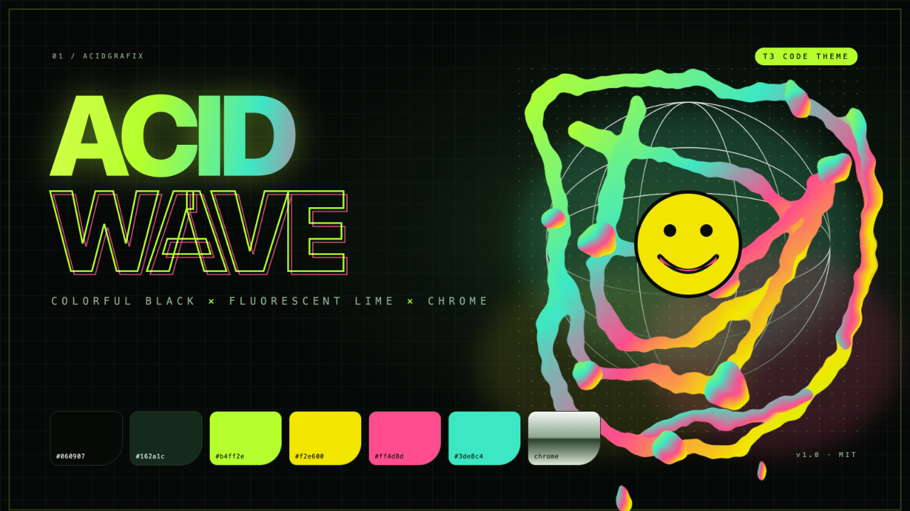
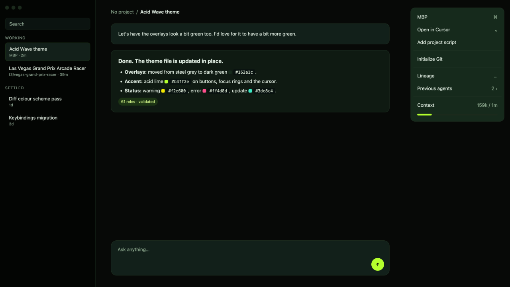
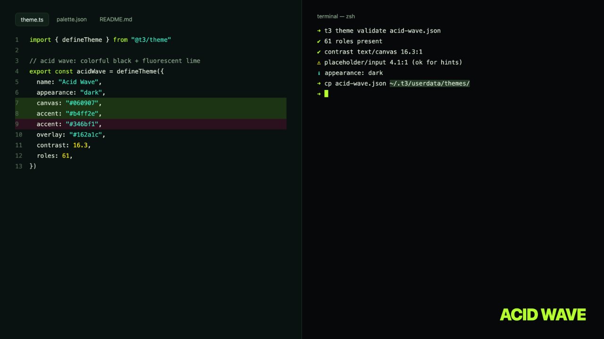

<p align="center">
  
</p>

# Acid Wave — a T3 Code theme

Colorful black, fluorescent lime, and liquid chrome. Inspired by Acid Design.

## Install inside T3 Code

1. Download [`acid-wave.json`](acid-wave.json) from this repo (or clone it).
2. Open T3 Code and go to **Settings → Appearance**.
3. Under the theme list, click **Add a theme**.
4. In the dialog, either drag `acid-wave.json` onto the drop zone (it says *Drop T3 Code or VS Code .json files*), click **Choose files** and pick it, or paste the file's JSON into the text box.
5. Click **Add theme**. **Acid Wave** now appears in your theme list under *custom* themes.
6. Select **Acid Wave**. It is a dark theme, so if your appearance is set to *System* or *Light*, switch to it directly or set it as your dark theme.

### Install from the terminal

T3 Code also reads themes straight from its user data folder, so you can skip the dialog:

```sh
# macOS / Linux
curl -fsSL https://raw.githubusercontent.com/matthewblack/acid-wave-t3-theme/main/acid-wave.json \
  -o ~/.t3/userdata/themes/acid-wave.json
```

Then pick **Acid Wave** in **Settings → Appearance**. Restart T3 Code if it does not show up right away.

### Remove it

In **Settings → Appearance**, hover the theme and use the remove action. You can bring it back anytime by importing the JSON again.

## In the app

<p align="center">
  
</p>

<p align="center">
  
</p>

## Palette

| Role | Hex |
|---|---|
| Canvas | `#060907` |
| Overlay | `#162a1c` |
| Text | `#e3efe4` |
| Muted text | `#8ca88e` |
| Accent (acid lime) | `#b4ff2e` |
| Warning (acid yellow) | `#f2e600` |
| Error (dusted pink) | `#ff4d8d` |
| Update (teal) | `#3de8c4` |

## Remix

The `hero/` folder holds the HTML sources for every image, so you can edit copy or colors and re-render. The theme file maps every T3 Code color role explicitly, so it is a good starting point for your own variant.

## License

MIT

---

With Much 💚🖤 Matthew Black
